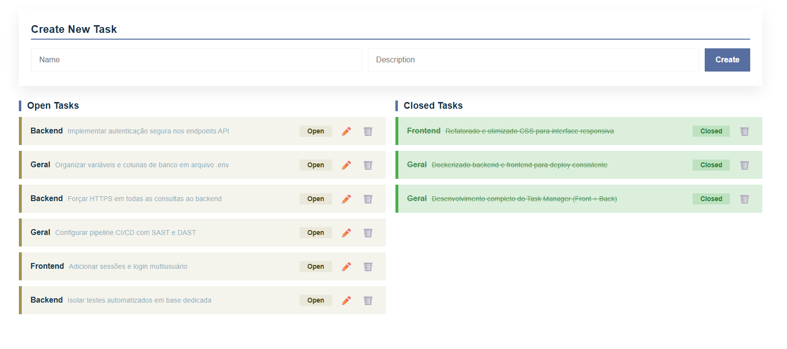

# Challenge TaskManager

> A full-stack task manager built for a coding challenge. FastAPI + SQLite backend, Next.js frontend, fully containerized with Docker Compose and covered by automated API tests, so the whole stack comes up with a single command.

<p align="center">
  
</p>

<table width="100%">
<thead>
<tr><th align="left">Stack<div></div></th><th align="left">Runs with<div></div></th><th align="left">Tested by<div></div></th></tr>
</thead>
<tbody>
<tr><td>FastAPI + SQLite backend, Next.js frontend</td><td>one command, via Docker Compose</td><td>an automated pytest suite, run before frontend integration</td></tr>
</tbody>
</table>

---

## Overview

Challenge TaskManager is a small CRUD application for managing tasks (create, list, update, delete), built to demonstrate a clean, production-shaped full-stack setup. The backend exposes a documented REST API; the frontend consumes it; and both run as isolated containers wired together by Docker Compose.

The architecture favors clarity over complexity: a lightweight SQLite store, a layered FastAPI backend (routes → services → models), and a Next.js UI, with `pytest` validating every endpoint before the frontend is integrated.

---

<details>
<summary><strong>Tech Stack</strong> (click to expand)</summary>

<table width="100%">
<thead>
<tr><th align="left">Layer<div></div></th><th align="left">Choice<div></div></th><th align="left">Why<div></div></th></tr>
</thead>
<tbody>
<tr><td>Frontend</td><td><strong>Next.js</strong></td><td>Easy backend integration plus server-side rendering (SSR/SSG) for better performance and SEO</td></tr>
<tr><td>Backend</td><td><strong>FastAPI</strong></td><td>High performance, async support, native Python tooling, and automatic API docs</td></tr>
<tr><td>Database</td><td><strong>SQLite</strong></td><td>Sufficient for the challenge scope without the overhead of a full DBMS</td></tr>
<tr><td>Deployment</td><td><strong>Docker Compose</strong></td><td>Reproducible environments with backend/frontend isolation</td></tr>
<tr><td>Testing</td><td><strong>pytest + TestClient</strong></td><td>Validates endpoint behavior before frontend integration</td></tr>
</tbody>
</table>

</details>

<details>
<summary><strong>API Endpoints</strong> (click to expand)</summary>

The backend exposes a single `tasks` resource. Interactive docs are available at `http://localhost:8000/docs` once the stack is running.

<table width="100%">
<thead>
<tr><th align="left">Method<div></div></th><th align="left">Route<div></div></th><th align="left">Description<div></div></th></tr>
</thead>
<tbody>
<tr><td><code>GET</code></td><td><code>/tasks</code></td><td>List all tasks</td></tr>
<tr><td><code>POST</code></td><td><code>/tasks</code></td><td>Create a task</td></tr>
<tr><td><code>PUT</code></td><td><code>/tasks/{id}</code></td><td>Update a task by id</td></tr>
<tr><td><code>DELETE</code></td><td><code>/tasks/{id}</code></td><td>Delete a task by id</td></tr>
</tbody>
</table>

> ℹ️ A task cap of **10** is enforced on create: exceeding it returns `400 Task limit of 10 reached!`. Unknown ids on update/delete return `404 Task not found!`.

</details>

<details>
<summary><strong>Requirements</strong> (click to expand)</summary>

- **Docker** and **Docker Compose**

That's it: dependencies for both services are installed inside their containers at build time.

</details>

<details>
<summary><strong>Running</strong> (click to expand)</summary>

All commands are run from the project root.

### Production

```bash
docker compose up --build -d   # build and start backend + frontend (detached)
docker compose restart         # restart without deleting data
docker compose stop            # stop without deleting data
docker compose down            # remove the containers
```

Once up:
- **Frontend** → `http://localhost:3000`
- **Backend API / docs** → `http://localhost:8000` / `http://localhost:8000/docs`

### Tests

```bash
docker compose run --rm backend pytest -v   # isolated test container, removed after the run
```

### Investigation & debug

```bash
docker compose ps                 # list active containers
docker compose logs -f backend    # follow backend logs
docker compose logs -f frontend   # follow frontend logs
```

</details>

<details>
<summary><strong>Project Structure</strong> (click to expand)</summary>

```
Challenge-TaskManager-main/
├── Backend/                        # FastAPI service
│   ├── Datas/base.db               # SQLite database
│   ├── Endpoints/routes.py         # API routes (GET/POST/PUT/DELETE /tasks)
│   ├── Models/models.py            # Request/response + DB data models
│   ├── Services/tasks.py           # Task business logic
│   ├── tests/test_routes.py        # Automated endpoint tests
│   ├── config.py                   # Backend configuration
│   ├── main.py                     # Ensures DB exists and starts the server
│   ├── requirements.txt            # Python dependencies
│   └── Dockerfile                  # Python image, deps via requirements.txt, runs Uvicorn
├── Frontend/                       # Next.js app
│   ├── components/                 # Shared models + API client
│   ├── pages/                      # Routes (index, _app, _document, 404)
│   ├── styles/                     # Global + task styling
│   ├── package.json                # Node dependencies
│   └── Dockerfile                  # Node image, deps via package.json, builds & runs Next.js
└── docker-compose.yml              # Defines services, images, env vars, ports, and network
```

</details>

---

## License

This project is provided as-is for reference and reuse. Adapt it freely to your environment.
